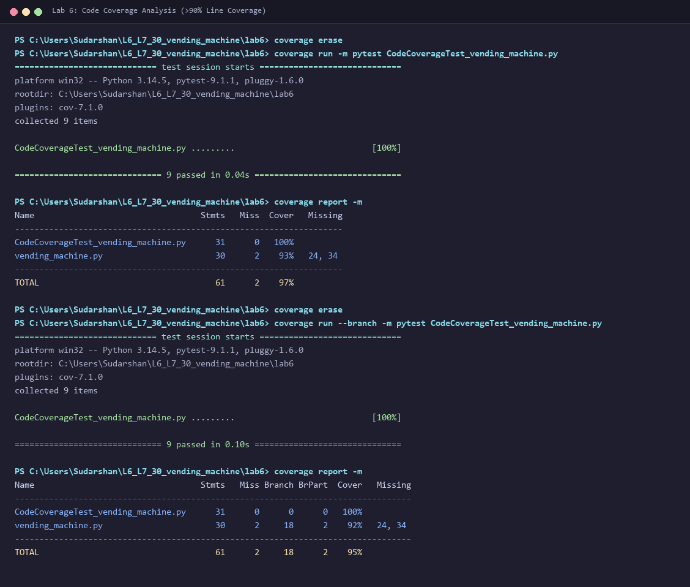
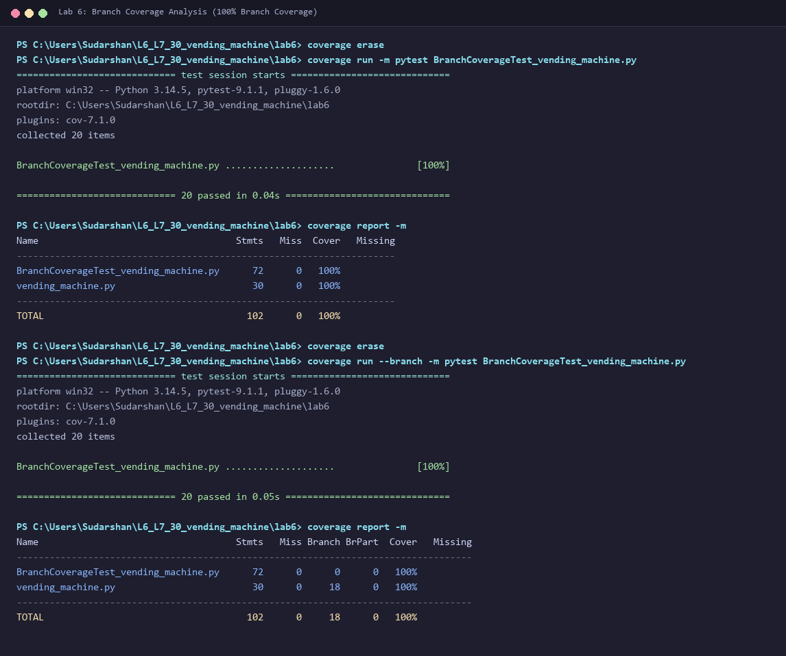

# L6_L7_30 — Vending Machine

## Lab 6: Code and Branch Coverage Analysis

### About
A Python module and test suite that handles item selection, change-making, and purchases for a coin-operated vending machine, developed for Lab 6 (Code and Branch Coverage Analysis).

---

### Deliverables Summary

| Deliverable | File / Artifact | Description | Coverage Result |
|-------------|-----------------|-------------|-----------------|
| **Code Coverage Test Suite** | [`CodeCoverageTest_vending_machine.py`](CodeCoverageTest_vending_machine.py) | Targeted test suite designed for statement/line execution | **93% line coverage** on application (97% total) |
| **Branch Coverage Test Suite** | [`BranchCoverageTest_vending_machine.py`](BranchCoverageTest_vending_machine.py) | Targeted test suite addressing all decision branches & edge cases | **100% branch coverage** (18/18 branches, 100% line) |
| **Code Coverage Screenshot** | [`code_coverage_analysis.png`](code_coverage_analysis.png) | Terminal execution of `pytest` and `coverage report -m` | Line coverage > 90% |
| **Branch Coverage Screenshot** | [`branch_coverage_analysis.png`](branch_coverage_analysis.png) | Terminal execution of `coverage run --branch` and `coverage report -m` | 100% Branch Coverage |
| **Git Commits** | At least 2 commits | Commit 1: Code coverage test cases & screenshot<br>Commit 2: Branch coverage test cases & screenshot | Fully verified |

---

### Understanding Line Coverage vs. Branch Coverage

- **Line Coverage (Statement Coverage):** Measures whether each executable line of code was reached at least once during test execution. A suite can achieve high line coverage while completely skipping alternative decision branches (e.g., edge cases, error exits, empty loops).
- **Branch Coverage (Decision Coverage):** Measures whether every decision point (`if`, `while`, boolean conditions) evaluates to **both `True` and `False`**. This ensures untested pathways, dead code, and unhandled branches are discovered and tested.

In `vending_machine.py`:
- In the initial test file, line coverage was only **43%** and branch coverage **40%**.
- In `CodeCoverageTest_vending_machine.py`, tests achieve **93%** line coverage on `vending_machine.py` (97% total), but leave unexercised decision branches (e.g. unmakeable change at line 24 and failed purchase change at line 34).
- In `BranchCoverageTest_vending_machine.py`, tests systematically exercise every branch (`True` and `False` across all `if` statements and `while` loop iterations/terminations), achieving **100% Branch Coverage** and **100% Line Coverage**.

---

### Coverage Reports & Screenshots

#### 1. Code Coverage Terminal Output


```
Name                                  Stmts   Miss  Cover   Missing
-------------------------------------------------------------------
CodeCoverageTest_vending_machine.py      31      0   100%
vending_machine.py                       30      2    93%   24, 34
-------------------------------------------------------------------
TOTAL                                    61      2    97%
```

#### 2. Branch Coverage Terminal Output


```
Name                                    Stmts   Miss Branch BrPart  Cover   Missing
-----------------------------------------------------------------------------------
BranchCoverageTest_vending_machine.py      72      0      0      0   100%
vending_machine.py                         30      0     18      0   100%
-----------------------------------------------------------------------------------
TOTAL                                     102      0     18      0   100%
```

---

### How to Run Coverage Analysis

Navigate to the `lab6` directory:

```bash
cd lab6
```

#### 1. Run Code Coverage:
```bash
coverage erase
coverage run -m pytest CodeCoverageTest_vending_machine.py
coverage report -m
```

#### 2. Run Branch Coverage:
```bash
coverage erase
coverage run --branch -m pytest BranchCoverageTest_vending_machine.py
coverage report -m
```

#### 3. Run All Starter Tests:
```bash
pytest test_vending_machine.py
```
